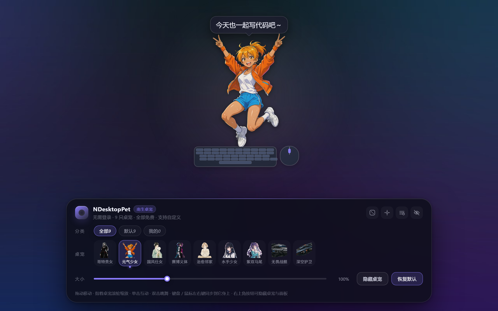
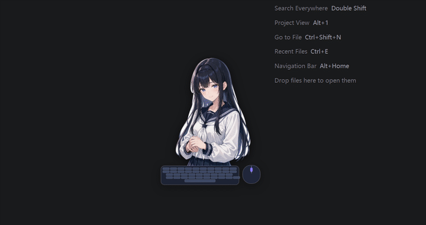
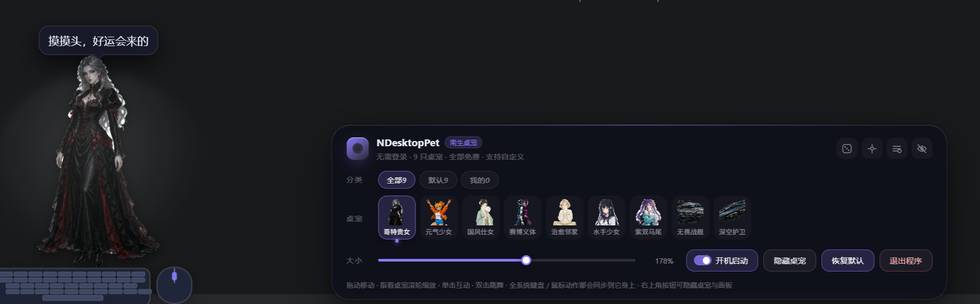
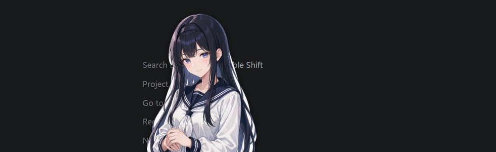
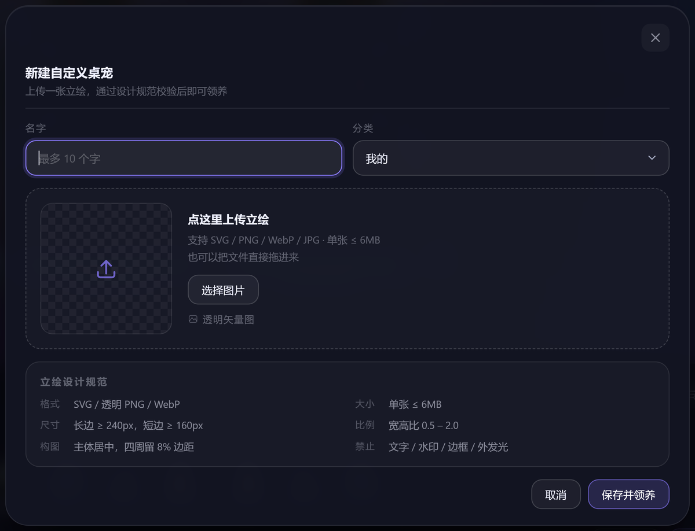
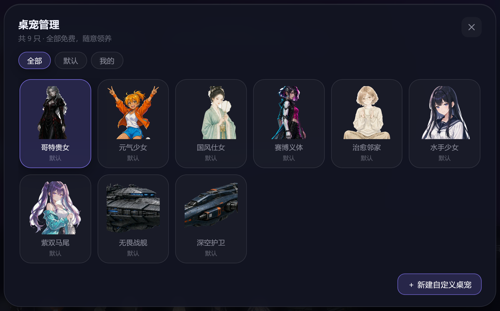

<div align="center">



# NDesktopPet · 南生桌宠

**一只住在你桌面上的小家伙。你敲键盘它跟着敲，你点鼠标它跟着动，还能换成你自己的立绘。**

[](LICENSE)
[](#-快速开始)
[](https://www.electronjs.org/)
[](#-隐私)
[](#-参与开发)

**零依赖 · 零 CDN · 断网可跑 · 数据只存在本地**

[特性](#-特性) · [快速开始](#-快速开始) · [操作](#-操作说明) · [自定义](#-自定义桌宠) · [打包](#-打包给别人用)

</div>

---

## 🎬 先看效果

<div align="center">

### ▶ <a href="https://maliangnansheng.github.io/NDesktopPet/">在线试玩 · 打开就能戳</a>

</div>

<div align="center">
  
</div>

<div align="center">
  
  &nbsp;
  
</div>

---

## ✨ 特性

| | |
| :-- | :-- |
| ⌨️ **键鼠实时同步**<br><sub>敲哪个键，迷你键盘同位置亮起；左右键、滚轮都有反馈</sub> | 🖥️ **真的浮在桌面上**<br><sub>透明置顶窗，除桌宠和面板外区域鼠标穿透，不挡你干活</sub> |
| 🎭 **9 只透明立绘**<br><sub>哥特贵女 / 元气少女 / 国风仕女 / 赛博义体 / 治愈邻家 / 水手少女 / 紫双马尾 / 无畏战舰 / 深空护卫</sub> | 🎨 **上传自己的立绘**<br><sub>SVG / PNG / WebP / JPG / GIF，白底自动抠图，现场校验构图规范</sub> |
| 🗂️ **自定义分类**<br><sub>除了 `全部` / `默认` / `我的`，还能自己建分类（限 3 个汉字）</sub> | 🔍 **10%–300% 缩放**<br><sub>真实宽高重排，不是 CSS 放大，放到 300% 也不发虚</sub> |
| 🌙 **一键隐身**<br><sub>桌宠和面板可分别隐藏，只留右下角一个小爪子</sub> | 💾 **纯本地存储**<br><sub>没有账号、没有服务器、不联网，清空浏览器数据就等于彻底清空</sub> |

---

## 🚀 快速开始

**⓪ 什么都不装，先在线试玩**

浏览器打开 → **[maliangnansheng.github.io/NDesktopPet](https://maliangnansheng.github.io/NDesktopPet/)**，能换宠、敲键盘、缩放、拖拽。
（透明置顶和全局键鼠监听是桌面版独有的，网页版看不到）

**① 直接下载安装包**（不装任何环境）

到 [Releases](../../releases) 拿对应系统的文件：Windows `.exe`、macOS `.dmg`、Linux `.AppImage`。

**② 源码跑起来**

桌面版（推荐 · 真的浮在桌面上）

```bash
npm install     # 首次会下载 Electron（约 100MB）
npm start
```

透明、无边框、始终置顶；鼠标点桌面其他位置会**穿透**到桌面，只有桌宠和面板可点。
桌面版用系统级监听**旁听**全机键鼠（不拦截、不改变你的输入），所以在 VS Code、浏览器里敲键盘，它也能看见。

> macOS 首次运行要去「系统设置 → 隐私与安全性 → 辅助功能」里把 NDesktopPet 勾上，否则全局监听会被系统静默拦掉。

<details>
<summary>国内下载慢？点这里</summary>

```bash
npm config set registry https://registry.npmmirror.com
# Git Bash / macOS
export ELECTRON_MIRROR=https://npmmirror.com/mirrors/electron/
# Windows PowerShell
$env:ELECTRON_MIRROR="https://npmmirror.com/mirrors/electron/"
npm install
```
</details>

---

## 🎮 操作说明

| 操作 | 效果 |
| :-- | :-- |
| 按住桌宠拖动 | 移动位置 |
| **指着桌宠**滚轮 | 放大 / 缩小（10%–300%），迷你鼠标的滚轮同时转动 |
| `Ctrl` / `⌘` + 滚轮 | 桌宠太小不好指时，任意位置的兜底缩放 |
| 单击 / 双击 | 跳一下说话 / 跳舞 |
| 敲键盘 | 桌宠键盘同位置的键亮起 |
| 按鼠标左键 / 右键 | 小鼠标对应键亮起，桌宠绕脚底向左 / 向右轻偏 2° |
| 面板「隐藏桌宠」 | 桌宠淡出，按钮变成「显示桌宠」 |
| 面板「开机启动」开关 | 开机自动打开桌宠（桌面版专属，浏览器版没有这个按钮） |
| 面板右上角 🚫 | **整个面板隐藏**，只留右下角小爪子 |

> 「开机启动」是写进系统的登录项：Windows 走注册表 `HKCU\Software\Microsoft\Windows\CurrentVersion\Run`，macOS 加到「系统设置 → 通用 → 登录项」，Linux 写一个 `~/.config/autostart/ndesktoppet.desktop`。便携版被挪到别的目录后，下次启动会自动把路径纠正过来。

> 分类只负责筛选下面的缩略图，**切分类不会换掉你正在养的桌宠**；想换哪只，就在列表里明确点它。

---

## 🎨 自定义桌宠

<div align="center">
  
</div>

面板右上角「管理」→「＋ 新建自定义桌宠」：

1. 填名字（最多 10 字，不填就叫「我的桌宠」）
2. 选分类：下拉里是 `我的` + 已有分类，最后一项 **「＋ 新建分类…」** 会展开输入框，**最多 3 个汉字**（`全部` / `默认` / `我的` 是保留名）
3. **点虚线框任意位置**就能选文件（按钮、预览区、提示文字都行），也可以直接把文件拖进去

**立绘规范**（不合规会当场提示并拦下保存）：

| 项目 | 要求 |
| :-- | :-- |
| 格式 | **SVG（最推荐）** / 透明 PNG / WebP / JPG / GIF（GIF < 1.2MB 保留动图） |
| 文件大小 | ≤ 6MB |
| 尺寸 | 长边 ≥ 240px，短边 ≥ 160px |
| 宽高比 | 0.5 – 2.0 |
| 构图 | 主体居中、四周留 8% 安全边距；不要文字、水印、边框、外发光 |

**白底自动抠图**：检测到四周白底（常见于 AI 出的 JPG 立绘）会自动泛洪成透明并羽化边缘，不用先去 PS。
**安全**：含 `<script>` / `foreignObject` 的 SVG 会被拒绝，防止脚本注入。

<div align="center">
  
</div>

「我的」里能看到全部自定义桌宠（同时也出现在它所属的分类里），悬停卡片右上角的红色 × 可删除，最多 24 个。

---

## 🗂 项目结构

```
NDesktopPet/
├── index.html              页面骨架（舞台 + 控制面板 + 管理弹窗）
├── package.json            依赖与 npm scripts
├── electron-builder.js     打包配置（含「跨平台时用哪份 electron」的判断）
├── package-lock.json       依赖版本锁
├── assets/
│   ├── css/style.css       全部样式与动效
│   ├── js/pets.js          桌宠引擎：9 只默认立绘 + 桌面道具（键盘 / 鼠标）
│   ├── js/app.js           交互：拖动 / 缩放 / 分类 / 管理 / 自定义
│   ├── pets/*.webp         9 张透明底立绘
│   └── icon.ico | icon.icns | icon.png   应用图标（Win / macOS / Linux）
├── electron/
│   ├── main.js             透明置顶窗口 + 鼠标穿透 + 全局键鼠监听
│   └── preload.js          安全桥接（contextIsolation）
├── scripts/
│   ├── build.js            打包入口（用当前 node 直接调 electron-builder）
│   ├── after-pack.js       打包后写入 exe 图标 / 版本号
│   └── check-target.js     打包前平台自检（mac 只能在 mac 上打等）
├── tools/rcedit-x64.exe    打图标用的小工具（仅打包时调用）
├── .github/workflows/      CI：三平台打包 + 发版
├── docs/screenshots/       README 用的截图与动图
└── LICENSE                 MIT
```

### 想加一只默认桌宠？

把图放进 `assets/pets/`，在 `assets/js/pets.js` 的 `PETS` 里加一行即可：

```js
{ id: 'maid', name: '女仆小姐', cat: 'default', image: 'assets/pets/maid.webp', alpha: true }
```

`alpha: true` 表示图本身是透明底；建议透明 WebP/PNG、最长边 640–800px、脚踩底边、四周留 8% 余量。

---

## 📦 打包给别人用

```bash
npm run build:win      # Windows → 安装版 + 免安装版
npm run build:mac      # macOS   → .dmg + .zip
npm run build:linux    # Linux   → AppImage + tar.gz
```

产物都在 `dist/`，统一命名成 `NDesktopPet-<版本>-<平台>-<架构>.<后缀>`：

| 平台 | 产物 | 说明 |
| :-- | :-- | :-- |
| Windows | `…-win-x64-setup.exe` | 安装版，可选目录、建桌面快捷方式 |
| Windows | `…-win-x64-portable.exe` | 免安装，双击即用，适合直接发给别人 |
| macOS | `…-mac-arm64.dmg` / `…-mac-x64.dmg` | 拖进「应用程序」即可 |
| Linux | `…-linux-x86_64.AppImage` | 单文件，`chmod +x` 后双击 |
| Linux | `…-linux-x64.tar.gz` | 解压后运行 `ndesktoppet` |

对方**不需要装 Node、不需要任何环境**。

### ⚠️ 每个系统只能打自己的包

| 你的系统 | `build:win` | `build:mac` | `build:linux` |
| :-- | :-: | :-: | :-: |
| Windows | ✅ | ❌ | ⚠️ 只出 tar.gz |
| macOS | ✅ | ✅ | ✅ |
| Linux | ⚠️ 需 wine | ❌ | ✅ |

### 想要三平台安装包？交给 GitHub Actions

仓库自带 `.github/workflows/build.yml`，不用配任何密钥：

- **手动跑**：Actions → *Build desktop app* → *Run workflow*，跑完在 Artifacts 里三平台各一份
- **发版本**：`git tag v1.0.0 && git push --tags`，自动建 Release 并把安装包挂上去

三个 runner 各跑原生系统，所以 mac 的 dmg、Linux 的 AppImage 都不需要你在本地折腾。

---

## 🔒 隐私

没有账号系统，没有埋点，没有网络请求。设置和自定义桌宠都存在本地（浏览器是 `localStorage`，桌面版存在 Electron 的用户数据目录）。

---


## 🤝 参与开发

欢迎 Issue / PR。二次开发、改名、内置到自己的产品里都可以，保留版权声明即可。

如果它让你的桌面热闹了一点 —— **点个 ⭐ 就是最好的鼓励** 🌙

---

## 📄 License

[MIT](LICENSE) © 2026 南生（Nansin）
